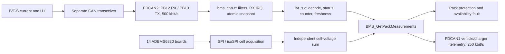

The 2026 BMS uses IVT-S Version 1.01 (16 February 2018, 43 pages) as the current/U1 protocol source. The supplied document is authoritative for this implementation. Relevant pages: 13 (CAN variants), 19-22 (IDs, framing, status, units and endian example), 24 (conflicting U1 default), and 40 (startup Alive).

The driver has no HAL dependency. `IVTS_Receive` accepts a normalized frame and a millisecond timestamp; `IVTS_GetSnapshot` derives independent channel validity/freshness at the supplied time. The caller serializes access. The STM32 adapter owns the driver and copies/evaluates its snapshot in a short interrupt-masked critical section, preserving the previous PRIMASK. The timestamp is sampled inside the same section. Driver values retain signed 32-bit mA/mV. The application exposes A/V without inversion; no positive/negative charge convention is assigned.

| Protocol field | Handling |
|---|---|
| Classical CAN 2.0A | Standard 11-bit data frames only; reject extended, remote and FD frames. |
| Current | Default ID 0x521, DLC exactly 6, DB0 exactly 0x00. |
| U1 | Default ID 0x522, DLC exactly 6, DB0 exactly 0x01. |
| Measurement | DB2-DB5, signed 32-bit big-endian; 1 mA/count or 1 mV/count. |
| Status | Expose full DB1 and its high-nibble result state. |
| Counter | Expose DB1 low nibble. Each channel has its own sequence. |
| Wrong DLC/mux on an expected standard result ID | Mark that channel's protocol validity false immediately. Record arrival time but do not refresh measurement time. |
| Unknown ID or wrong frame format | Reject/ignore without refreshing measurements. |
| Cyclic counter | Accept 15-to-0 rollover. Duplicate counter invalidates that result and does not extend freshness. A nonduplicate gap is diagnostic and accepted as the newest result; CAN packet loss need not permanently prevent recovery. |

Result-state handling is explicit:

| High-nibble bit | Datasheet meaning | Driver policy |
|---|---|---|
| 0 / OCS | Overcurrent status true. | Preserve the number and expose the bit. This bit alone does not make the measurement untrustworthy. Existing application current limits remain responsible for numeric current protection. |
| 1 | This result is outside specification, has reduced precision, or has a measurement error. | Invalid. The bit cannot distinguish harmless precision degradation from measurement error; no reduced-precision result is silently trusted. |
| 2 | Any result has a measurement error. | Invalid. Conservatively inhibit the other cached channel as well until it receives a new clean result. This may inhibit current/U1 even if the underlying error is an unused IVT channel. |
| 3 | System error; sensor functionality not ensured. | Invalid. Inhibit the other cached channel until it receives a new clean result. |

`last_received_ms` records arrivals on a result ID, including malformed DLC/mux frames. `last_measurement_ms` records a well-formed result with counter progress (including a result carrying error bits). These timestamps are not equivalent to last-valid data. Raw value/status are retained for diagnostics even when status is invalid. A snapshot is valid only if it has a result, passes protocol/status checks, is not a duplicate or peer-inhibited result, and remains fresh. A status-error result can therefore be fresh and invalid simultaneously.

The default current timeout is 100 ms and U1 timeout is 300 ms. These are application watchdog choices (five times the documented 20/60 ms intervals), not guarantees from the datasheet. Both timeouts are configurable through `IVTS_Config`; freshness ends at age >= timeout. Unsigned timestamp subtraction handles HAL tick rollover. The periodic safety check runs every 100 ms, so physical fault-output response can add up to one timer period after a watchdog expires. Four-bit counter progress cannot prove authenticity, detect every out-of-order replay, or distinguish a loss of exactly sixteen frames. Receive timestamps do not replace an IVT application checksum or configuration verification.

Alive is accepted on the configured response ID (default 0x511), DLC 8, DB0=0xBF. The response ID/DLC follows the response-message table on page 19; page 40 specifies the Alive payload fields but does not independently state an ID/DLC. DB1-DB2 provide the command ID; DB3-DB6 provide the big-endian serial number. The public snapshot exposes arrival time, count, command ID and serial. Alive is diagnostic only and invalidates cached channel measurements/counter history and configuration verification, allowing clean recovery after a sensor restart. Other eight-byte response messages are retained verbatim as an extension point for future GET-response verification.

The sensor's U1 startup configuration is **unverified**. Page 19 says U1 is disabled; page 24 says cyclic. The driver assumes neither behavior and sends no SET, STORE, trigger, reset or bitrate command. A missing U1 stays stale/invalid even when current is healthy. `configuration_verified` remains false; future verified GET/response handling may call `IVTS_SetConfigurationVerified`. Receiving Alive or plausible results never sets this flag. IDs, byte order, actual output mode/intervals and the sensor's persisted bitrate must ultimately be verified. This driver implements the documented big-endian defaults; little-endian results cannot be reliably identified from payload bytes alone.

FDCAN1 remains the existing vehicle/charger interface on PA11/PA12 at 250 kbit/s. It has not been retimed for the sensor. FDCAN2 is proposed for IVT-S on PB12/PB13. It was initialized but unused and not started in the original application. Both peripherals share the FDCAN kernel clock divider: the local STM32 HAL writes CKDIV only while initializing FDCAN1. With configured PCLK1=128 MHz and the unchanged DIV2, both controllers see 64 MHz. FDCAN1 stays prescaler 16, TSEG1=13, TSEG2=2: 250 kbit/s. FDCAN2 uses the same 16 time quanta and prescaler 8: 500 kbit/s, 87.5% sample point. Prescaler 16 or 4 also supports 250 kbit/s or 1 Mbit/s by changing `IVTS_CAN_BITRATE`; unsupported rates fail compilation. The CubeMX project records the 500 kbit/s default; a nondefault build must keep regenerated timing/settings consistent. A runtime PCLK1 guard prevents silently using the timing against an unexpected clock.

Two standard dual-ID filters admit only current, U1 and response IDs into FIFO0. Nonmatching standard, all extended and remote frames are rejected on FDCAN2. Software validates frame metadata again. FDCAN2 IT0/NVIC and its IRQ handler are enabled. Receive callbacks drain FIFO0 and handle notification bits as a mask. Buffers accommodate the HAL's possible 64-byte copy before format validation. FDCAN1 retains its transmit/charger routing; charger parsing now also checks its frame type and DLC. FIFO loss/read failure or bus-off invalidates the IVT measurements. FIFO-loss handling discards queued frames from that episode; fresh later results are required. No automatic bus-off restart or sensor reconfiguration is attempted.

The previous ADBMS2950 application state, initialization/configuration branches, shunt-current conversion, pack-voltage conversion, read functions and main-loop calls are removed. The generic command/type library still contains historical ADBMS2950 definitions; they are unused by this application. The isoSPI chain contains fourteen ADBMS6830 devices only. `BMS_GetPackMeasurements` exposes IVT signed current, IVT U1, the independent cell-voltage sum and U1-minus-cell-sum difference. ADBMS acquisitions are staged and published only after a complete checked pass; the prior complete snapshot remains available until success, failure or age expiry. Failed acquisitions invalidate all ADBMS measurements. Cell and AUX snapshots expire independently, using provisional 1000 ms limits. The cross-check is diagnostic and asynchronous; no discrepancy fault threshold is invented. See `safety-comms-bringup.md` for the current safety/communication configuration.

Pack status checks use IVT current/U1 without the former `TOTAL_AD29` guard. Provisional pack limits remain 336.0-470.4 V and -10 to +10 A. Missing/invalid current sets CURRENT plus IVT faults; missing/invalid U1 sets VOLTAGE plus IVT faults. `BMS_ERR_IVT` is separate from isoSPI `BMS_ERR_COMMS`. The timer checks live IVT availability/current and ADBMS freshness, holds the shutdown fault and disables charging on failure. The main-loop fault handler stops discharge; an IVT-only fault does not enter isoSPI retry/reset handling. Safety values now reside in `bms_safety_config.h`. Segment limits derive from eight positions, pack limits from 112. Balancing is disabled and PWM-capped at zero pending configuration review; temperature conversion and LED policy are unchanged.

Vehicle telemetry retains all existing 112 cell/TEMP IDs, fourteen board IDs and the charger frame. Three new extended IDs follow the board range:

| ID | Bytes 0-3 | Byte 4 | Byte 5 | Byte 6 | Byte 7 |
|---|---|---|---|---|---|
| 0xB07E / current | Signed mA, little-endian | Raw DB1 | Counter | Flags | 0 |
| 0xB07F / U1 | Signed mV, little-endian | Raw DB1 | Counter | Flags | 0 |

Cross-check ID 0xB080 contains signed cell-sum mV in bytes 0-3 and signed U1-minus-cell-sum mV in bytes 4-7, both little-endian.

Current/U1 flags in byte 6: bit 0 valid, bit 1 stale, bit 2 received, bit 3 configuration verified, upper bits zero. Invalid result numbers use INT32_MIN; always inspect the validity bit because the underlying signed protocol also permits INT32_MIN. Cross-check fields use INT32_MIN when unavailable or not representable. There are 130 frames when all fourteen boards communicate. Vehicle telemetry's little-endian encoding is independent of IVT-S's big-endian receive encoding. Receiver/DBC updates are required; no external dashboard was modified.

Hardware-dependent items remain:

- STM32 PB12/PB13 must reach a **separate** compatible CAN transceiver and an IVT bus with the correct termination, enable/standby state, supply and grounding/isolation arrangements. Do not connect buses running different bitrates together. Firmware pin allocation is not proof of PCB routing.
- The available downloaded master schematic uses a different MCU and does not establish a second transceiver for this STM32 design. A matching master/HAT schematic or bench wiring check is still required. No transceiver enable pin was invented.
- The actual IVT part must include U1 voltage measurement and its HV U1 leads must span the intended pack. Sensor ID/serial, persisted bitrate, output modes and byte order are unverified.
- Sensor current direction and the vehicle's charge/discharge convention are deliberately unassigned. Physical installation/polarity must be checked before any directional policy is added.
- Watchdog budgets require review against the verified sensor configuration and vehicle safety timing.
- The retained +/-10 A application limit is a legacy value, now applied to IVT data; it is not an approved Formula Student operating-current limit.
- External thermistor Celsius remains unconfirmed/invalid. Segment limits now derive from eight positions (provisionally 24.0-33.6 V). The inherited 3.0 V aggregate UV basis differs from the 3.3 V cell UV setting and still needs approval.
- No hardware was flashed. Actual bus timing, routing, termination, Alive ID/DLC, startup traffic, electrical sensor wiring and fault-output behavior remain bench checks.

Run `python tests/run_host_tests.py --cc /path/to/gcc` to compile/run the HAL-independent synthetic-frame tests and application-integration tests. An optional `--build-dir` retains executables/logs. The tests cover signed current/U1, the datasheet's fixed big-endian vector, malformed IDs/DLC/mux/frame formats, all status combinations, rollover/duplicate/gap behavior, independent freshness/deadlines/tick wrap, Alive and transport invalidation, primary IVT versus independent cell sum, preserved numeric limits, telemetry and failed-cell-read independence. The application test uses the real wrapper and sensor driver with hardware stubs; older host compilers get host-only zeroed ADC command globals because they reject pre-existing firmware struct-copy initializers. ARM firmware builds use the real command source.
